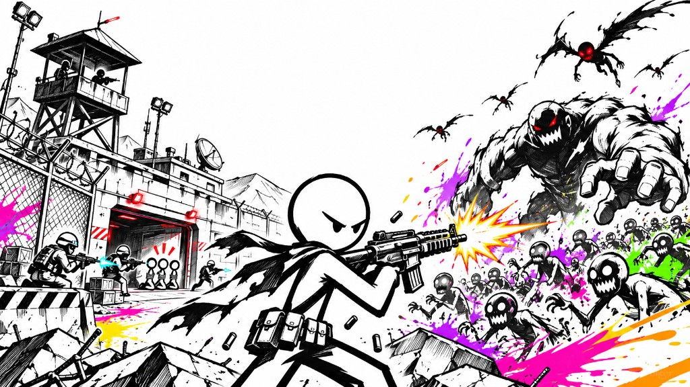
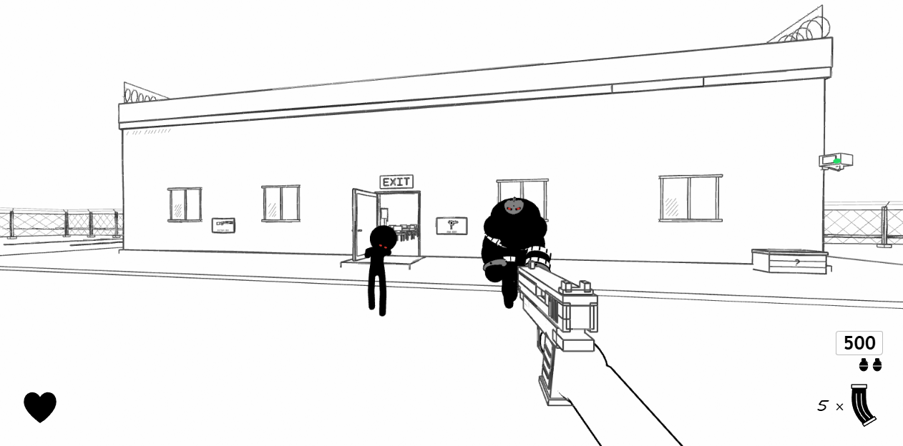
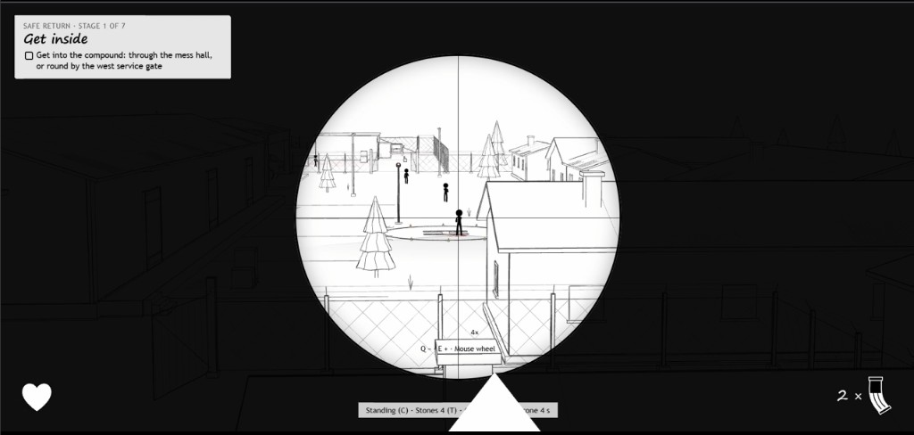
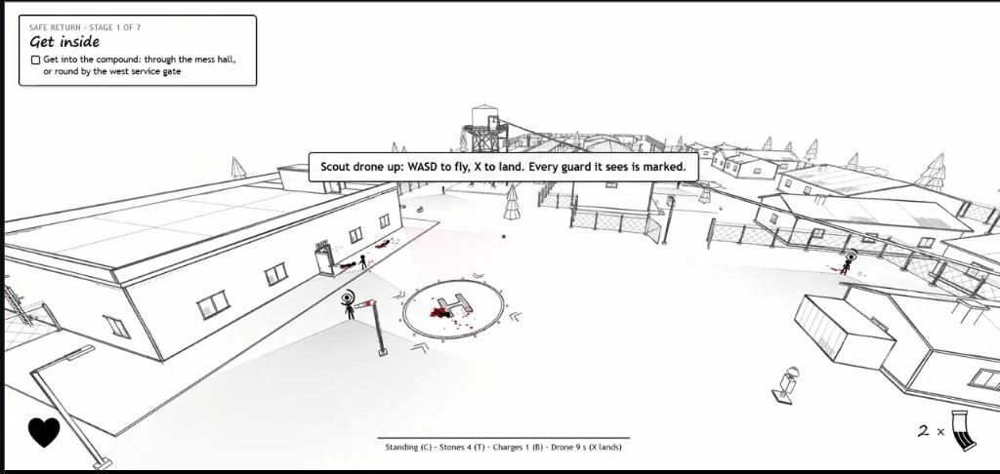
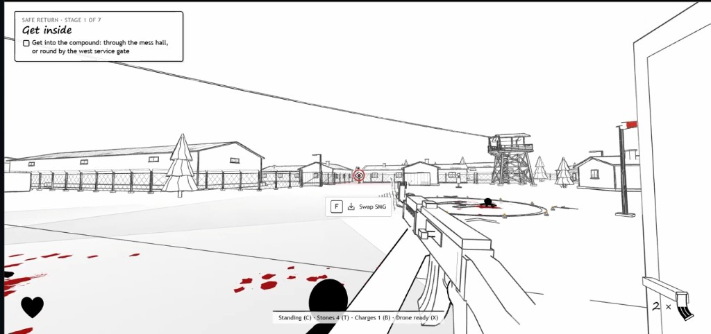
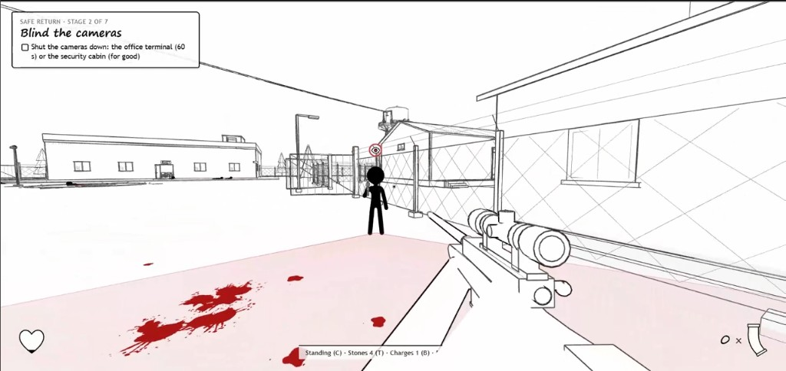

<div align="center">
  
  <h1>Dead Ink</h1>
  <p>A solo browser shooting game with a hand-drawn paper look.</p>
  <p>Play endless zombie rounds or switch to Operation Safe Return and rescue the hostages.</p>
  <p><strong><a href="https://youtu.be/-Qa60i-NFZM">Watch the gameplay demo</a></strong></p>
</div>

## Screenshots

<div align="center">
  
  
  
  
  
  
</div>

## Features

- Five hostage rescue missions
- Endless zombie rounds
- Boss and special enemies
- Wall guns, Mystery Box and blocked areas to unlock
- Colourful paintball shots and wall splashes
- Keyboard, mouse and controller support

## Run the game

```sh
npm install
npm run dev
```

Open the address shown in the terminal.

- Hostage missions: `/`
- Zombie mode: `/?mode=zombies`

## Main controls

- Move: `W A S D`
- Aim and shoot: mouse
- Interact or buy: `F`
- Reload: `R`
- Knife: `V`
- Grenade: `Q` or `G`
- Pause: `Esc`

## Credits

Some art, assets and gameplay mechanics were taken from open-source projects.

Sound sources are listed in [public/sounds/CREDITS.md](public/sounds/CREDITS.md).
