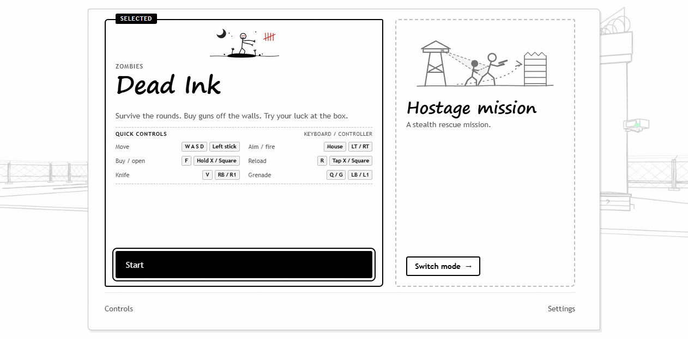

# Dead Ink

A solo browser shooting game with a hand-drawn paper look.

Play endless zombie rounds or switch to Operation Safe Return and rescue the hostages.

## Screenshots




## Features

- Five hostage rescue missions
- Endless zombie rounds
- Boss and special enemies
- Wall guns, Mystery Box and blocked areas to unlock
- Colourful paintball shots and wall splashes
- Keyboard, mouse and controller support

## Run the game

```sh
npm install
npm run dev
```

Open the address shown in the terminal.

- Hostage missions: `/`
- Zombie mode: `/?mode=zombies`

## Main controls

- Move: `W A S D`
- Aim and shoot: mouse
- Interact or buy: `F`
- Reload: `R`
- Knife: `V`
- Grenade: `Q` or `G`
- Pause: `Esc`

## Credits

Some art, models and other assets were sourced from GitHub projects, including
[dead-ink](https://github.com/fundedkaizen/dead-ink) and
[operation-ink](https://github.com/byteab/operation-ink).

Sound sources are listed in [public/sounds/CREDITS.md](public/sounds/CREDITS.md).
